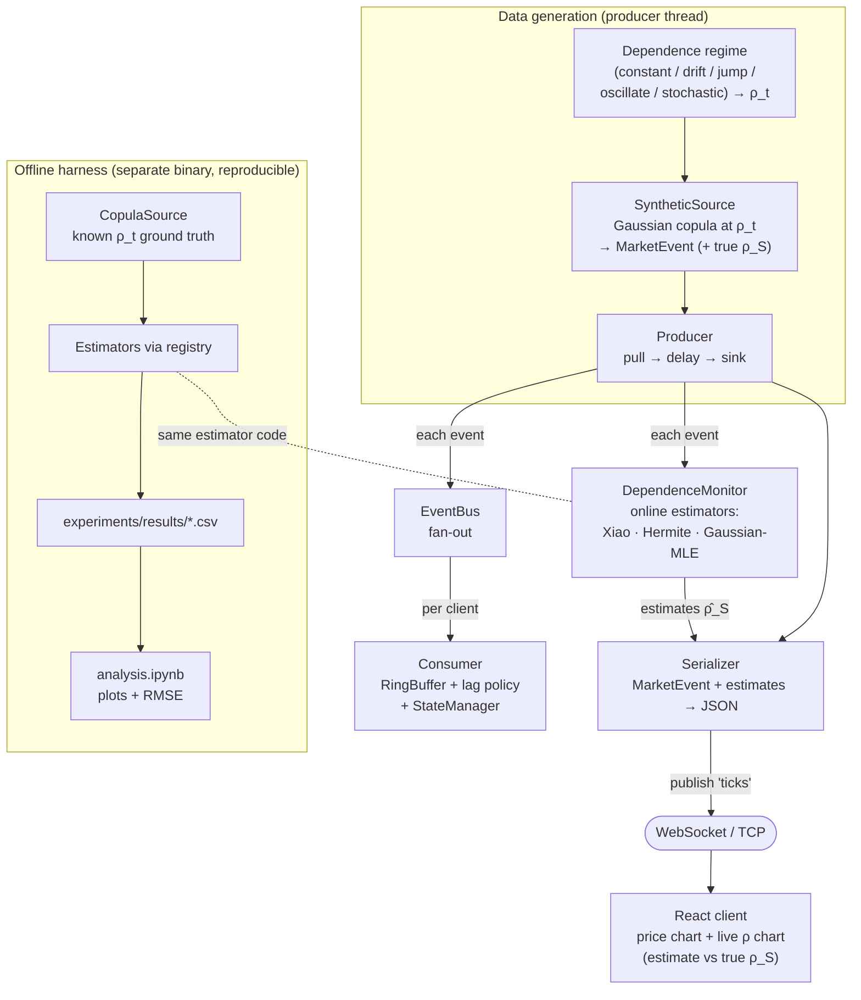

# datastreamer

Real-time market-data streaming system with online copula-dependence estimation. A C++20 server
generates synthetic correlated market events, streams them over WebSockets (TCP), and estimates a
time-varying dependence parameter online; a React client renders live price + dependence charts.

## System design



The server has **two delivery paths** off the producer: the `DependenceMonitor` (server-side online
estimation, broadcast to all clients) and the per-client `EventBus`→`Consumer` analytics path. The
offline harness reuses the **same estimator code** against a known ρ_t so results are reproducible
and scored by RMSE.

## Run the live app

```bash
./run.sh dev     # build backend + start Vite dev server (hot reload)
./run.sh prod    # build frontend + backend, serve everything on the config port
```

Or manually:

```bash
make server && ./server          # backend + WebSocket on port 9002 (see config.json)
cd client && npm run dev         # frontend at http://localhost:5173
```

`source .venv/bin/activate` for the Python tooling.

Client WebSocket URL (in `client/.env`):
- `VITE_WS_URL=ws://localhost:9002` for dev
- `VITE_WS_URL=wss://<your-ngrok-host>/` for prod (`ngrok http 9002`)

### Live dependence regime

The server drives the synthetic stream with a `Dependence` regime chosen at launch via the
`DEPENDENCE` env var (default `oscillate`):

```bash
DEPENDENCE=constant ./server     # fixed rho
DEPENDENCE=drift    ./server     # linear ramp
DEPENDENCE=jump     ./server     # abrupt step
DEPENDENCE=oscillate ./server    # sine (default)
DEPENDENCE=stochastic ./server   # latent random walk
```

## Experiments (offline evaluation)

Nonparametric online estimators (Xiao, Hermite) evaluated against a known time-varying
ground truth. Code and outputs live under `experiments/` (outputs in `experiments/results/`).

```bash
cd experiments && make                               # separate Makefile; Eigen only, no server deps
for s in constant drift jump stochastic oscillate; do ./experiment $s; done
# CSVs -> experiments/results/experiment_<scenario>.csv
```

Analysis: `experiments/analysis.ipynb` (plots + RMSE tables; reads `experiments/results/`).

Live accuracy probe (connects to the running server, logs estimates vs truth):

```bash
python experiments/live_probe.py --csv experiments/results/live.csv
```

Write-ups and design docs are in `notes/`.

## Layout

```
src/            C++: producer, broker, estimators, device/consumer, standalone consumer
client/         React + Vite frontend (display)
experiments/    offline harness (own Makefile), analysis notebook, live probe, results/
notes/          architecture, roadmap, experiment write-ups
external/        submodules: uWebSockets, hermiter + onlineNPCORR (reference impls)
```
