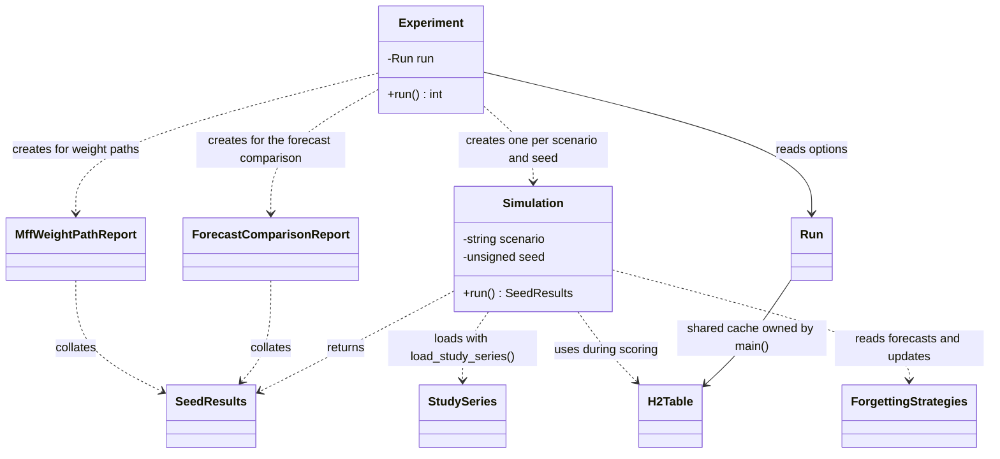
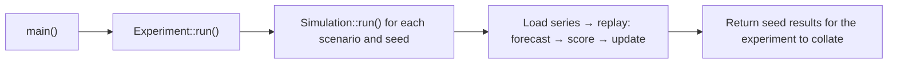

# Simulation design

**Status.** The layout below reflects `reruns`. Commit `8af5f5a` records 41 matching reference outputs for the earlier baseline. The latest regret and family loop changes are in the working tree and await verification.

`src/` generates the stream. The experiment supplies a family, dependence scenario, seed, and observation count. The standard run, family modes, regret modes, and fixed-ESS sweep use `load_study_series()` to prepare and store the observations for replay.

## How observations reach the experiments

- **In-process.** `make_scenario()` supplies a target Spearman correlation for each tick. `CopulaSource` uses that schedule and a seeded sampler to draw the pair. The experiment receives the draws and their ground truth from the code in `src/`. [Scenario factory](../../../src/streamgenerator/datasource/dependence.hpp#L81) · [Copula source](../../../src/streamgenerator/datasource/copula.hpp#L168)
- **Live.** The server uses the same copula draw path. `SyntheticSource` turns draws into price ticks and carries the truth alongside them. The experiment's TCP adapter reconstructs paired returns the same way the consumer does. A live experiment therefore receives reconstructed returns, while an in-process experiment receives the original draws. [Synthetic source](../../../src/streamgenerator/datasource/synthetic_source.hpp#L24) · [TCP adapter](../../simulation/run_live_stream.hpp#L46)
- **Preparation for scoring.** The study adapter stores the observations, ground truth, and shared KLL pseudo-observations computed using the preceding pairs. Modes that score against the generating parameter compute it separately. Buffering lets several estimators or forecast variants score exactly the same observations. [Study adapter](../../simulation/study_stream.hpp#L28) · [Standard simulation](../../simulation/simulation.cpp#L35)

The source should continue to own the dependence schedule, copula sampling, and random number generator. The experiment should own its choice of streams, replay policy, metrics, and outputs. The live device can continue consuming one observation at a time, without a stored study series.

The TCP adapter also stays a separate header. `real_data_comparison.cpp` includes it directly for file replay, so folding it into the study adapter would pull the study's KLL preparation into the real-data runner.

## Files before the refactor

The standard strategy run, family scoring, family switching, and regret modes link into one executable. The section scripts start the executable, and Python reads the resulting CSVs. [Build entry points](../../build.sh) · [Section workflows](../../README.md)

| File | Responsibility | Direct users or outputs |
|---|---|---|
| `strategy_experiments.cpp` | Dispatch modes and run the standard strategy comparison, weight paths, and validation | §6.3–6.5 section scripts, live jobs, and the checksum check |
| `family_scores.cpp` | Compare squared and log loss across working families and learning rates | `score-family`, §6.4 analysis and heatmaps |
| `family_switching.cpp` | Measure identification, adaptation, and predictive accuracy when the generating family stays fixed or switches | `family-switching`, §6.5 analysis and figures |
| `strategy_regret.cpp` | Compare predictive loss with the best fixed and switching sequences | `regret` and `regret-family`, §6.4 regret analysis |
| `fixed_ess_sweep.cpp` | Sweep fixed memories and measure error, bias, variance, and jump recovery | §6.2 figures and tables, live jobs, and the checksum check |
| `real_data_comparison.cpp` | Score forecasts and rolling benchmarks on observed returns | §6.6 analysis and figures, and the checksum check |
| `budget_benchmark.cpp` | Measure accuracy, retained state, and timing across settings | §6.7 budget tables and figures, and the checksum check |
| `margin_ablation.cpp` (now `margin_comparison.cpp`) | Measure how different marginal estimation methods affect accuracy | §6.7 marginal estimation report |
| `strategy_runs.hpp` | Declare modes and share replay data, fixed arms, inverse lookups, and window summaries | The four strategy source files |
| `study_stream.hpp` | Adapt in-process or live observations and provide shared KLL margins | Strategy runs and the fixed-ESS sweep |
| `run_live_stream.hpp` | Start the server and reconstruct paired returns from TCP ticks | The study adapter and the real-data runner |
| `family_hellinger.hpp` | Tabulate working densities and cache truth densities for Hellinger scoring | Family scoring and family switching |
| `regret_oracle.hpp` | Compute fixed and switching comparators from a loss matrix | Both regret modes |
| `test/device_vs_probe.cpp` | Score the device on synthetic draws or reconstructed returns | The in-process device comparison |
| `test/lab_vs_device.cpp` | Compare the browser lab's forecasts with the device | The browser-lab consistency check |

## Current design

For each seed, **run the producer, run the consumer logic, score the forecasts, and collate the results**. In process, “run” means calling the producer and consumer code in `src/` directly. With `LIVE=1`, the loader starts the server and reads the series over TCP.

1. **Producer.** Load one seeded series per scenario and seed with `load_study_series()`. `CopulaSource` generates the observations through `src/`. In live mode, the loader reads the same kind of observations from the TCP adapter after reconstructing returns from price ticks.
2. **Consumer.** Replay each pair into the estimator strategies in `src/`. The series carries one shared pair of KLL pseudo-observations per stream. The standard run uses the existing `ForgettingStrategies` on those prepared inputs. The family and regret modes keep the shared fixed-memory bank with their own weighting or oracle logic.
3. **Score.** Evaluate the forecast held before the pair was absorbed. The scoring functions in `src/` use the generated truth for accuracy and copula density comparisons. The estimator still returns Spearman correlation. The scorer converts it to a copula parameter for the chosen working family.
4. **Collate.** Keep scenario and seed selection, accumulated statistics, CSV output, and optional diagnostics in the experiments. Python reads the same CSVs.

Every strategy mode **replays a stored series**. The standard runner already generates each seed's observations once, and the TCP adapter already buffers its input, so a single-pass loop would mainly make the standard run look more like the live consumer. A stored series is a recording of the producer's observations. Replaying it does not call the generator a second time. Revisit streaming if incremental TCP processing becomes a goal.

A future single-pass loop has one constraint. DataSketches flips its compaction coins with a thread-local generator, so every consumer of that generator changes the draws of every other one. Today the study adapter reseeds it once and owns the only pair of DataSketches margins. The estimator strategies consume those pseudo-observations or raw values and flip no coins of their own. If `Device` owns a single-pass loop, it must also own margin preparation, with the study adapter's KLL removed from that path. [Device](../../../src/estimators/device.hpp#L51) · [Study adapter](../../simulation/study_stream.hpp#L42)

The budget and margin benchmarks run each estimator start to finish and still read estimates after updating. The fixed-ESS and real-data forecasting runners keep their existing order. KLL seeding, the use of prior pairs for pseudo-observations, and the distinction between in-process draws and reconstructed live returns carry through this design.

## Experiment and Simulation

An `Experiment` covers the full study. A `Simulation` covers one scenario and one seed. The forecast comparison and the `weights` mode share these classes. The family and regret modes have their own entry functions, fixed-memory bank, and weighting or oracle logic.

| Class | Owns | Main method |
|---|---|---|
| `Experiment` | The scenario and seed loops for the forecast comparison and weight paths. | `run()` and `run_weight_paths()` create a `Simulation` per seed and pass its results to the corresponding report. |
| `ForecastComparisonReport` | The CSV outputs and the per-scenario sums across seeds. | `add()` collates one seed's results and writes its per-seed rows. `end_scenario()` writes the summaries across seeds. |
| `MffWeightPathReport` | The MFF and plain-Hedge weight summaries and CSVs. | `add()` collects one seed's paths and writes its window scores. `end_scenario()` writes the paths averaged across seeds. |
| `Simulation` | The configuration and lifetime of one seeded run. | `run()` loads and replays one series. It records forecast scores or weight paths before updating the estimators and returns `SeedResults`. |

`main()` constructs an `Experiment` for the forecast comparison or weight paths. Each `Simulation` uses the same replayed series for all configured estimators. `main()` owns the `H2Table` used by the forecast comparison, family modes, and validation. The experiment passes each `SeedResults` value to its report for aggregation and CSV output.

### UML class diagram



Scoring calls the shared functions in `src/estimators/` with the shared `H2Table`. The loader fills the series from `CopulaSource` in process, or from reconstructed TCP returns in live mode.

### Call order



## Current file structure

Section-local programs sit next to their `run.sh`, analysis, and plots. The sources for the shared `strategy_experiments` executable, replay adapters, and consistency checks live in `experiments/simulation/`. [Build targets](../../build.sh#L18)

```text
src/
  streamgenerator/datasource/    Existing producer and scenario code
  estimators/
    device.hpp                 Shared fixed bank, strategy state, and Device
    evaluation.hpp             Shared scoring and Hellinger calculations
    scorer.hpp                 Scoring adapter for the live consumer

experiments/
  6.2-fixed-forgetting/
    fixed_ess_sweep.cpp          Fixed-memory accuracy and recovery
  6.6-real-data/
    real_data_comparison.cpp    Real-data forecasts and rolling benchmarks
  6.7-computational-cost/
    budget_benchmark.cpp        Accuracy, memory, and timing
    margin_comparison.cpp       Accuracy across marginal estimation methods
  simulation/
    csv_list.hpp                Shared comma-separated option parser
    study_stream.hpp            Replay input from in-process draws or TCP
    run_live_stream.hpp         Server start and return reconstruction over TCP
    experiment.cpp              main(), mode dispatch, and Experiment
    simulation.hpp/.cpp         Simulation, SeedResults, and the single-seed forecast loop
    simulation_reports.hpp/.cpp ForecastComparisonReport, MffWeightPathReport, and window summaries
    strategy_runs.hpp           Run options, mode declarations, and small runner helpers
    validate.cpp                `validate`: table and density checks
    working_families.hpp        Working families, rho_S tables, and family Hellinger
    family.cpp                  Family scoring and switching
    regret.cpp                  Regret modes and their oracle
    test/
      device_vs_probe.cpp       Device and experiment comparison
      lab_vs_device.cpp         Browser lab and device comparison
```

`regret.cpp` owns the hindsight oracle. The family inverse tables and family Hellinger scorer live in `working_families.hpp`. The live consumer and standard simulation share the Gaussian forecast scoring in `src/estimators/evaluation.hpp`.

Within the strategy executable, the file boundaries are for navigation and linking.

- **`experiment.cpp`** reads options and dispatches modes. For the standard comparison, `Experiment::run()` loops over scenarios and seeds, calls `Simulation::run()`, and writes the aggregated results.
- **`simulation.cpp`** runs one scenario and seed. It loads the series, replays it through the estimator strategies and scorer in `src/`, and returns `SeedResults`.
- **`simulation_reports.cpp`** collates `SeedResults` across seeds and writes the `strategies_*` CSVs. Its window summary is shared with the family modes.
- **`strategy_runs.hpp`** holds the run options and the mode entry points. `Experiment` stays private to `experiment.cpp`.
- **`family.cpp`** keeps the two family comparisons together. One compares scoring rules across working copulas. The other measures adaptation when the generating family changes. Both modes need family-specific weighting and density scoring. Their entry functions stay separate, and both link into the same executable as the standard loop.
- **`regret.cpp`** owns both regret modes and their shared oracle. It compares forecast losses with the best fixed and switching sequences.

`margin_comparison.cpp` runs the same generated data through each way of estimating the margins (known margins, empirical ranks, KLL approximations) and reports how much accuracy each one costs. The executable has the same name.

## Initial refactoring order

1. Add `load_study_series()` to the study adapter. Move the strategy runner's and the fixed-ESS sweep's loaders onto it, keeping the single KLL reseed and shared pseudo-observations.
2. Share the fixed-memory bank and scoring in `src/`. Preserve warm-up, KLL seeding, forecast timing, and numerical methods. If the standard run moves onto `Device` later, make the `src/` change first: configurable VFF rates and access to the mixture diagnostic's inputs.
3. Group the experiment files and split the standard comparison into `experiment.cpp` and `simulation.cpp`. Check that every existing mode reaches the same output.

## Mode functions before consolidation

Before consolidation, the mode functions combined environment options, CSVs, scenario and seed selection, and per-tick work. The table records their sizes at that point.

| Function | Lines |
|---|---|
| `run_famswitch` (`family.cpp`) | 145 |
| `run_scoresfam` (`family.cpp`) | 138 |
| `main` (`fixed_ess_sweep.cpp`) | 93 |
| `run_regret` (`regret.cpp`) | 88 |
| `main` (`real_data_comparison.cpp`) | 83 |
| `run_regretfam` (`regret.cpp`) | 64 |
| `run_weights` (`experiment.cpp`) | 58 |

Much of that length repeated MFF. At that point, `Mff` supported only the five study arms, so modes that needed a 20-arm family mixture or another learning rate rebuilt it from the weight-update helpers.

| Repeated piece | Copies |
|---|---|
| MFF mixture log density (log-sum-exp over weighted arm densities) | 5 |
| MFF point forecast (weighted mean, clamped) | 3, besides `Mff::estimate` |
| Per-arm working-copula loss | 4, besides `Mff::score_and_update_weights` |
| Readiness rule `t >= 30 && arms.ready()` | 4, besides `Mff::ready` |
| The four working families, their names and inverse tables | 3 |
| Comma-separated environment lists | 4 |
| Mean and standard deviation across seeds | 2 |
| Output open and the "run from the experiment folder" check | 7 |

`run_weights` mostly duplicates the standard run. Its δ = 1e-4 rows replay the same arms and the same `Mff` that `ForgettingStrategies` holds, in the same scoring order, so their weights, squared errors and mean forecasts are already computed there. Only the δ = 0 Hedge comparison is new. `SeedResults` can carry the MFF weight path, and the weight outputs can come from the standard run, with δ = 0 as an extra strategy enabled only under the `weights` mode.

### Order

These steps landed on `final-edits` and were merged into `reruns`. The stored validation reference includes the family table checks emitted by `validate`.

1. Let `Mff` take any number of arms, a learning rate and a share rate. Give it `forecast()`, `mixture_log_density()`, `mixture_loss()` and `update()`, and name the 30-tick warm-up. The family, regret and real-data modes then hold `Mff` values instead of raw weight vectors. Keep each mode's existing log-sum-exp form and loss guard, so outputs stay identical.
2. Move the table self-checks in `run_scoresfam` and `run_famswitch` into `validate`.
3. Add a working-family table (family, name, inverse), one list parser, one results-file opener, and one across-seed mean and standard deviation.
4. Move `FamilyInverse` and `FamilyHellinger` into `working_families.hpp`, where family, regret, and validation modes access their shared tables and scoring helpers.
5. Produce the weight paths from the standard run as above, and move `run_validate` out of `experiment.cpp`.

## Regret and family loops

**Status.** The first three items are in the `reruns` working tree and await a build and output comparison.

Regret is MFF's cumulative loss minus the best hindsight comparator: the best fixed arm, the best path with at most one switch, and the best with at most two. The seeds file needs each comparator over the whole run, plus the arms and tick of the one-switch path. The paths file needs each comparator at every tick. The per-tick comparators need a dynamic program over switch count and arm, which is the oracle in `regret.cpp`. That part of the length is essential.

Done on `reruns`:

1. **One regret loop.** `collect_regret_losses()` walks a seed for both modes and returns the scored ticks, guarded arm losses, and the mixture and point losses for each share rate. Each mode passes its own arm-loss rule. The family mode counts clamped and non-finite losses. The Gaussian mode asks for point losses. The CSV rows stay in each runner. For each estimator and share rate, `RegretPaths` holds separate `mixture` and `point` arrays of `TickMoments` indexed by switch budget.
2. **One grid pass in family switching.** Each tick fills the arm forecasts, the true-PIT densities and, once the weights can update, the update losses in one pass over family × memory. Scoring still precedes the weight update. The Gaussian loss copy still precedes the separate guards.
3. **Strided weight-path sums.** The across-seed accumulator stores one row per emitted `famsw_path` tick, every tenth tick. The per-seed history still contains every tick for the family identification metrics.

Deferred for this rerun:

| Change | Saves | Cost or decision |
|---|---|---|
| Limit regret paths to the figure's jump scenario, mixture loss, and switch budgets 0 and 1 | Eight of nine scenario × loss × budget combinations | Keep the full `regret_paths.csv` for this rerun. Trimming is a separate output change that would change the reference hash. [Figure inputs](../../6.4-copula-density/plots.py#L129) |
| Recover the one-switch arms and tick by backtracking the dynamic program | The separate prefix-sum scan | Keep the scan to preserve comparison order, floating-point behavior, and the chosen arms and tick when losses tie or nearly tie. |
| Share true-PIT log density and estimated-PIT update loss through `arm_terms()` | A small amount of repeated code | Keep the calculations at the call sites. They make the two PIT inputs and each mode's handling of nonfinite densities visible. |

Keep the score comparison and family switching loops separate. Score comparison replays cached forecasts for one working family across learning rates and loss rules. Switching advances live arms, compares a 20-arm mixture with a 5-arm one, and tracks family weights. A single loop would need a branch for each of those differences.

## Verification

Each path has its own pass condition.

| Path | Check | Pass condition |
|---|---|---|
| Linux, in process | [`check.sh`](../../check.sh) | Every output hash matches `check_reference.txt` exactly |
| Margin comparison | Before-and-after run with the same seeds | Identical outputs. `check.sh` does not run this benchmark |
| Live (`LIVE=1`) | Rerun with the same seeds | Matches the previous live run. The [documented differences](../../README.md#L45) between live and in-process runs are not by themselves grounds for a change |
| In-process draws versus returns | [`test/device_vs_probe.cpp`](../../simulation/test/device_vs_probe.cpp) | Reproduces the `mixture` rows |
| Standalone TCP consumer | [`live/run_live.sh`](../../live/run_live.sh) | Matches its previous results |
