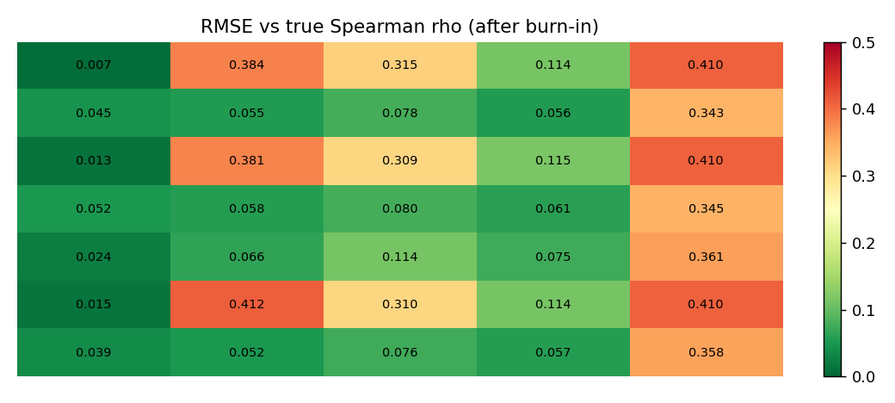
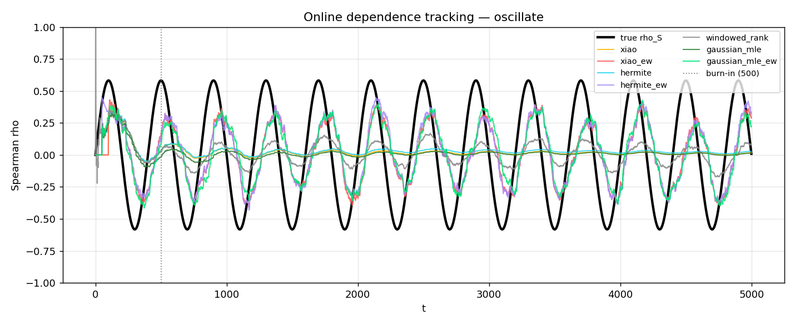
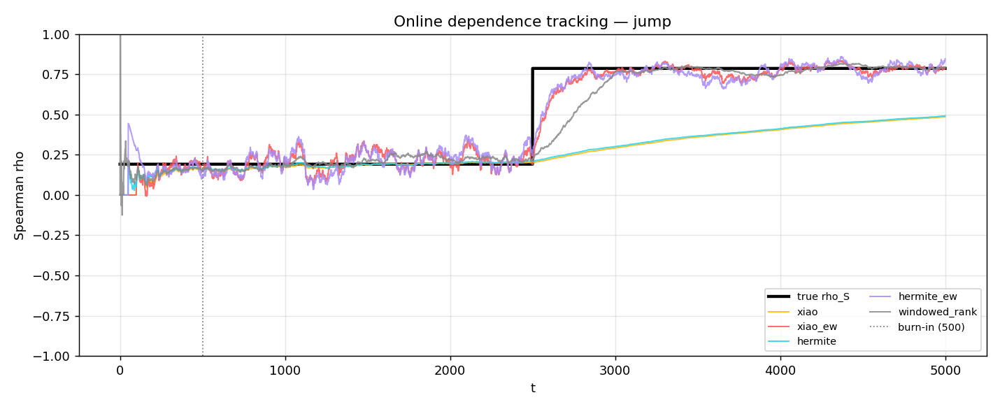
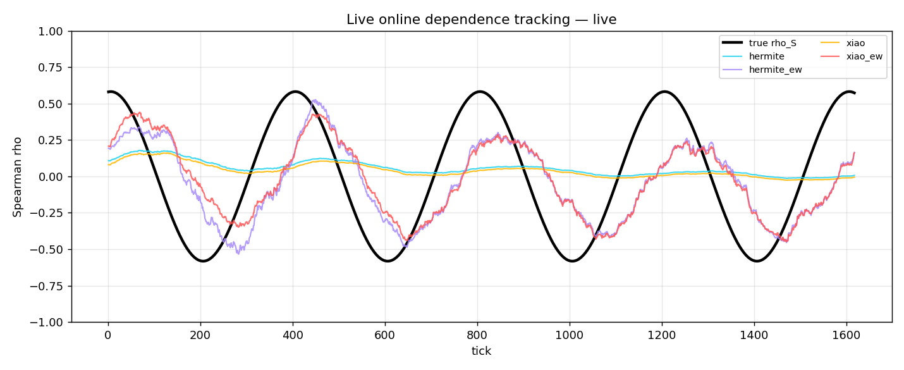
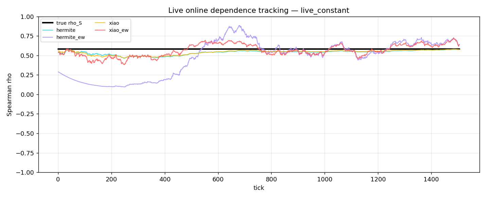
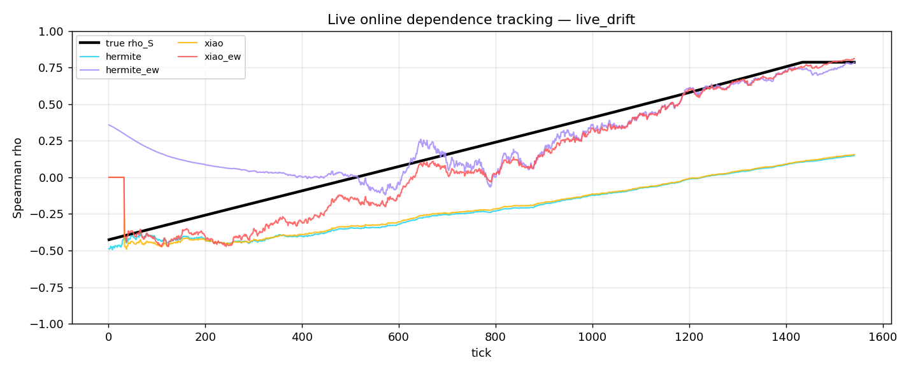

# Experiment 1 — Online nonparametric dependence estimation (2026-08-18)

**Question.** When copula dependence changes over time, how should a streaming estimator trade
**stationary efficiency** against **adaptation to change**? Compared cumulative vs
exponentially-forgetting variants of two nonparametric Spearman-rho estimators — **Xiao**
(streaming empirical copula) and **Hermite** (series expansion) — both offline (batch, seeded)
and live (real-time over the WebSocket).

Code + outputs: `experiments/` (harness `main.cpp`, `analysis.ipynb`, `results/`).

## Setup

- **DGP:** bivariate Gaussian copula whose linear correlation rho_t is driven by a `Dependence`;
  true Spearman rho_S = (6/pi)*asin(rho/2) is emitted per step as ground truth.
- **Scenarios:** constant, drift (ramp), jump (step), stochastic (latent random walk),
  oscillate (sine, period 400).
- **Estimators (offline == online, single source of truth in `registry.hpp` /
  `dependence_monitor.hpp`):**

  | estimator | forgetting | effective memory |
  |---|---|---|
  | `xiao`, `hermite` | none (cumulative) | all history |
  | `xiao_ew` | lambda=0.99 (retention) | ~200 ticks |
  | `hermite_ew` | lambda=0.01 (update weight) | ~100 ticks |

  The lambda knob is mirror-imaged between the two families; both `_ew` variants mean "forget
  over ~100-200 observations".

## Offline results — RMSE vs true rho_S (after burn-in 500)

| estimator | constant | drift | jump | stochastic | oscillate |
|---|---|---|---|---|---|
| xiao        | **0.007** | 0.384 | 0.315 | 0.114 | 0.410 |
| xiao_ew     | 0.045 | **0.055** | **0.078** | **0.056** | 0.343 |
| hermite     | **0.013** | 0.381 | 0.309 | 0.116 | 0.410 |
| hermite_ew  | 0.052 | 0.058 | 0.080 | 0.061 | 0.345 |
| windowed_rank | 0.024 | 0.066 | 0.114 | 0.075 | 0.361 |

**The trade-off, cleanly.** Cumulative wins when rho is **constant** (0.007 vs 0.045, ~6x tighter);
forgetting wins the moment rho **moves** (drift/jump/stochastic: ~0.06 vs ~0.38). The ordering
flips between the constant column and the changing columns — that flip is the result.

**Why cumulative is *so* bad on change (not just worse):** a cumulative estimator converges to the
*time-average* of rho. For a zero-mean oscillation that average is ~0, so it sits flat while the
truth swings +-0.58 (corr with truth ~0, not merely lagged). It has no forgetting, so after enough
data each new point moves it by ~1/t and it goes deaf.

**Oscillate is hard for everyone** (best ~0.34): the 400-tick period is close to the forgetting
window, so even adaptive estimators lag and attenuate. `windowed_rank`'s hard 500-window is
slightly worse than the EW variants here.

Per-scenario tracking plots: `results/offline_{constant,drift,jump,stochastic,oscillate}.png`.

## Live results (real-time over the WebSocket) and offline/online agreement

Captured with `live_probe.py` while the server ran each schedule. With **matched estimator
configs and matched oscillate period (400)**, the online path reproduces the offline numbers:

| estimator | oscillate offline | oscillate **live** |
|---|---|---|
| xiao        | 0.410 | 0.422 |
| xiao_ew     | 0.343 | 0.353 |
| hermite     | 0.410 | 0.424 |
| hermite_ew  | 0.345 | 0.345 |

Within ~0.01 — the residual is just different random seeds / run lengths. **The real-time system
and the batch analysis agree**, which validates the whole online path (server-side monitor →
serialization → TCP → probe).

Live per-schedule RMSE (warm-up 120):

- **constant** (`live_constant.png`): xiao **0.052**, hermite **0.054** beat xiao_ew 0.079,
  hermite_ew 0.237 — cumulative wins, as offline. (hermite_ew's low order-10 + aggressive lambda
  is too twitchy on a flat target.)
- **drift** (`live_drift.png`): xiao_ew **0.137**, hermite_ew 0.154 beat cumulative ~0.48 —
  forgetting wins.
- **oscillate** (`live.png`): forgetting ~0.35 vs cumulative ~0.42.

## Known issue — `hermite_ew` long cold-start ($\sim 800$ ticks)

`hermite_ew` is badly biased early, worst on the near-stationary scenarios. On live constant
($\rho_S^{\text{true}} = 0.582$) it reads $\sim 0.19$ at $t=50$, sags to $\sim 0.10$ by $t=150$,
and only recovers late:

| phase | hermite_ew RMSE | xiao_ew RMSE |
|---|---|---|
| early ($50$–$300$) | $0.458$ | $0.125$ |
| mid ($300$–$800$)  | $0.264$ | $0.076$ |
| late ($800{+}$)    | $0.072$ | $0.058$ |

**Cause (fixable).** In EWMA mode Hermite seeds the standardisation variance at $1.0$, but the
returns $r = 10^{-4} + 10^{-2} z$ have variance $\sim 10^{-4}$. With $\lambda = 0.01$ it decays as
$1.0 \cdot 0.99^{\,k}$, hitting the right scale only after $k \approx \ln(10^{-4})/\ln(0.99)
\approx 900$. Until then $(x-\mu)/\sqrt{\sigma^2}$ divides by too large a variance, so inputs are
tiny and $\hat\rho$ is shrunk toward $0$ — matching the recovery timescale. (Secondary: coefficient
matrix $A$ is EWMA-initialised at $0$, only $\sim 40\%$ built at burn-in $50$.)

**Why others avoid it:** cumulative `hermite` uses $m_2/(n-1)$ (correct scale in a few samples);
`xiao_ew` is rank-based and batch-inits from $100$ calibration samples.

**Fix:** decouple moments from coefficients — cumulative (Welford) variance for standardisation,
forgetting only on $A$. The marginal scale is stationary; only the dependence needs forgetting.

## A correction worth recording

Earlier I attributed the offline/live gap to different lambda settings. That was wrong: matching
the estimator configs barely moved the numbers (offline oscillate 0.225 -> 0.226). The gap was
almost entirely the **oscillation speed** — offline used period 1000, live used 400. After
matching the period the two agree. Lesson: the difficulty is set by the **rate of change relative
to the forgetting window**, not by the estimator internals.

## Takeaways / next steps

- The efficiency<->adaptation trade-off holds both offline and live, for both estimator families;
  Xiao and Hermite agree with each other throughout (independent cross-check).
- The controlling quantity is (rate of change) vs (effective memory / ESS). The clean thesis
  figure is a **sweep**: vary oscillation period (or jump size) x lambda, and map where each
  estimator is best — the bias/variance/lag frontier.
- Current numbers are **single-seed**; add multi-replication averaging + error bars, plus explicit
  post-change recovery-time / detection-delay metrics, before anything goes in the thesis.
- Then: parametric online MLE / Fisher-scoring branch, and CUSUM change-detection + restart (the
  `reset()` hook is already in the estimator interface).
