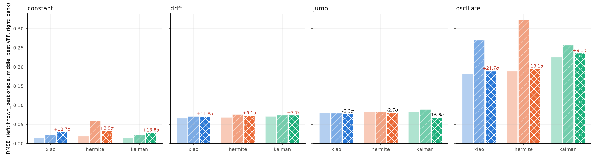
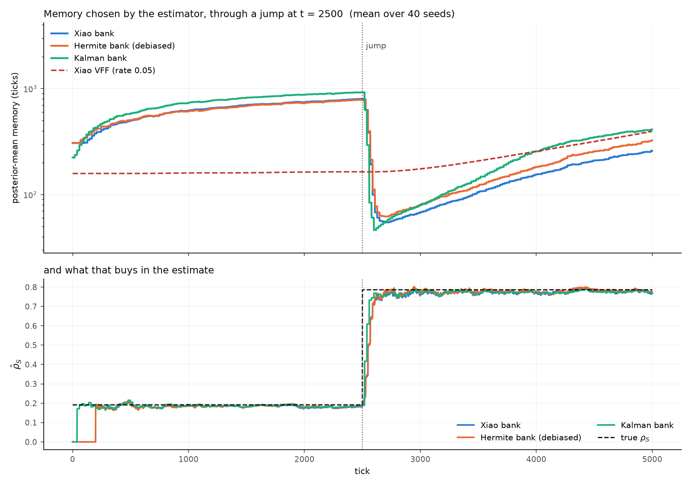

# Does adaptive memory generalise past the filter?

Branch: `adaptive-memory` (off `memory-sweep`). Code: `experiments/probe_adaptive.cpp`,
`experiments/plot_adaptive.py`, `experiments/show_adaptive.py`. Data:
`experiments/results/adaptive_memory{,_pairs,_traj}.csv` — regenerated in ~16 s by §9, since
`experiments/results/` is gitignored. Figures are copied to `notes/studies/figures/`.

Read `memory_sweep.md` first; this is its direct successor and reuses its protocol, its ESS
conversion and its warnings.

§14.16 of `kalman_changepoint_results.md` is the thesis's headline contribution: a **bank** —
a posterior over memory length — adapts its own memory through a change and beats the best
fixed memory chosen per scenario *after* seeing the answer. It was measured on **one estimator**,
the local-level Kalman filter, because that is the only one with a predictive density to score
arms by. Findings 1 and 2 are measured on Xiao and Hermite. So the headline rested on less
evidence than the support.

This note fills the table. The short answer:

- **The mechanism generalises completely.** All three banks collapse their memory 13–20× within
  ~150 ticks of the jump and relax back, in near-lockstep (Figure 1). Nothing about that
  behaviour was Kalman-specific.
- **The RMSE win generalises, but it is small, and it happens on `jump` only.** Xiao −3.3σ,
  Hermite −2.7σ, Kalman −16.6σ. Everywhere else all three banks *lose* to the oracle.
- **One incumbent number does not reproduce and should be retracted**: the Kalman bank's
  8.2σ win on `drift` was measured against an under-resolved oracle. Against a properly
  resolved one it is a 7.7σ **loss** (§6).
- **`xiao_vff` was built and it does not work well enough to carry a row.** A VFF can be
  built for Xiao — the scale problem is solvable — but it adapts far too slowly to beat a
  bank on any scenario, on any of the three families (§5).

---

## 1. Design

### 1.1 Protocol, which is the predecessor's exactly

`N = 5000`, burn-in 500, jump at `t = 2500`, Gaussian copula, scenarios `constant`, `drift`,
`jump`, `oscillate`, **40 seeds (42…81)**, scored over ticks 500…5000. `stochastic` is skipped
for `memory_sweep.md` §1's reason: every seed draws a different true path.

This is not a claim, it is checked. `probe_adaptive` rebuilds the same 20-point fixed memory
grid the predecessor swept, and its RMSE **agrees with `results/memory_sweep.csv` on all 200
shared cells to 0 (exactly, not to tolerance)**. If the protocol had drifted, that check would
have failed.

`rho_true` is `CopulaSource::Sample::rho_s`, the true Spearman's ρ_S, as before.

### 1.2 The mirror-image λ, verified at the source again

Not taken on trust from the brief or from the predecessor:

| Estimator | λ is | Longer memory | Source |
| --- | --- | --- | --- |
| Xiao | **retention** | **larger** λ | `xiao_spearman.hpp:246-256` — `counts_ *= l` then `+= (1 - l)`, so α = 1 − λ |
| Hermite | **update weight** | **smaller** λ | `hermiter.hpp:101-118` — `w = lambda_`, `A_ += w * (outer - A_)`, so α = λ |
| Kalman | `σ_ω²` | **smaller** `σ_ω²` | `kalman_local_level.hpp:62-68` — steady-state K rises with q |

Everything below is specified in **ticks of effective memory**, `ESS = (2−α)/α`, and the λ is
derived from that. No grid was copied across families.

### 1.3 The bank arm grids, in ticks

The brief's key constraint: arms set by effective memory, not by any family's native parameter.
7 arms, log-spaced **25 → 1000 ticks**. That span is chosen to match the incumbent
`kalman_bank`'s own nominal span (22 → 999 ticks) so all three banks reach the same memories.

| arm | 1 | 2 | 3 | 4 | 5 | 6 | 7 |
| --- | --- | --- | --- | --- | --- | --- | --- |
| **memory (ticks)** | 25.0 | 46.2 | 85.5 | 158.1 | 292.4 | 540.7 | 1000.0 |
| **Xiao λ** (retention) | 0.923077 | 0.957657 | 0.976878 | 0.987430 | 0.993183 | 0.996308 | 0.998002 |
| **Hermite λ** (update weight) | 0.076923 | 0.042343 | 0.023122 | 0.012570 | 0.006817 | 0.003692 | 0.001998 |

The Kalman bank keeps its **registered** grid `σ_ω² ∈ {1e-4, 1e-3, 1e-2, 3e-2, 1e-1, 3e-1, 1e0}`,
nominal memory **999, 316, 102, 61, 37, 27, 22** ticks, so the incumbent row is literally the
incumbent. Note `memory_sweep.md` §3: the Kalman's three shortest arms are all pinned at the
20-tick block floor, so its effective span is 22–999 with the bottom third collapsed (trap 4).

`switch_prob` = 0.002 for all four banks (`EstimatorBank::Config{}`'s default, and
`kalman_bank_sticky`'s value). Nothing else was tuned.

### 1.4 `xiao_bank` / `hermite_bank` are a run, not a build — but the registered configs are not what was run

The claim in the brief checks out. `EstimatorBank` (`src/estimators/dependence/estimator_bank.hpp`)
is generic and its arm scoring is sound, not a stub:

```
u, v  = rank-PIT pseudo-observations       (bounded window, 500)
point = 12 (u - 1/2)(v - 1/2)              unbiased for rho_S, one tick
s_k   = point - rho_hat_k                  scored BEFORE the models absorb the tick
ll_k -= s_k^2 / (2 v_mix)                  accumulated over a 20-tick block, then Bayes
```

That is a Gaussian predictive score with a variance `v_mix` shared across arms. The shared
variance drops the log-determinant term, which is a constant across arms and cancels in the
normalisation, so the ranking is a proper likelihood ratio. Two honest caveats:

- Because the variance is shared, the score cannot reward an arm for being *confident*, only
  for being *close*. `KalmanBank` does carry a per-arm `F_k = P_pred,k + σ_v²` and does get the
  determinant term. That is the one structural difference between the two banks, and it is a
  plausible part of why the Kalman bank's `jump` win (−16.6σ) is five times the Xiao bank's
  (−3.3σ).
- The residual is scored **per tick** rather than per block, so the generic bank sees 20× the
  sample rate of `KalmanBank` — the §14.10 property. This works in its favour.

What the registered `xiao_bank` / `hermite_bank` / `mle_bank` keys have is a **λ grid, not a
memory grid**: `xiao_bank` runs λ ∈ {0.95 … 0.999} (memory 39 → 1999) and `hermite_bank` runs
λ ∈ {0.05 … 0.001} (memory 39 → 1999). Those two happen to be matched to each other, but neither
is matched to `kalman_bank`'s 22–999, and `hermite_bank`'s longest arm at memory 1999 is inside
the warm-up region the predecessor flagged (trap 2). So the registered keys were **not** used for
the numbers here; the probe builds memory-matched banks, as `probe_memory.cpp` builds
memory-matched fixed configs and for the same reason.

### 1.5 `known_best` is the oracle, and it cheats

For each family and each scenario, the single best fixed memory on **that** scenario, chosen
after seeing the answer. Selected as the argmin over the 20-point memory grid of the pooled
RMSE — the same quantity and the same argmin as **`results/memory_sweep.csv`, column `rmse`, rows
with `window = all`**. Verified identical (§1.1). The probe recomputes it only so that the
*paired* per-seed differences exist; `memory_sweep.csv` carries `se_rmse` but not the per-seed
series, and every σ below is a paired-over-seeds σ.

A second, non-cheating baseline is reported alongside: **`one_setting`**, the single fixed memory
with the best mean RMSE across all four scenarios, chosen once and used everywhere. That is what
a practitioner actually has.

---

## 2. Trap 2 bit, and it bit the oracle itself

`memory_sweep.md` §6.2: Hermite has no EWMA initialisation debiasing, so above ~500 ticks of
memory at `N = 5000` it is still warming up. The predecessor measured 0.450 at ESS 30 000,
`t = 5000`, against a truth of 0.582.

Of the three options in the brief — cap the grid, raise N, or debias — **debiasing was chosen**,
because the other two are both worse here:

- Capping "where Hermite is provably warm" means memory ≤ 217 ticks (§5.1 of the predecessor).
  That is shorter than the Kalman bank's own longest arm (999), so the banks would no longer
  span comparable memory — which the brief forbids — and it would hand `constant` to the Kalman
  by construction.
- Raising `N` would break the protocol match with `memory_sweep.csv`, and `constant`'s optimal
  memory is a function of N, so `known_best` would no longer be the predecessor's `known_best`.

The fix is one line: divide the three EWMA accumulators by the weight they have actually
accumulated, `wsum ← wsum + w(1 − wsum)`, i.e. `1 − (1−w)^n`. Xiao is immune because its estimate
is a scale-invariant *ratio* of EWMA'd counts; Hermite's ρ is not homogeneous in its accumulators
(its four terms are degree 3, 2, 2 and 1 in them), so the shrinkage does not cancel and has to be
divided out. It is **off by default** (`HermiteEstimator::Config::debias = false`), so no
registered number in the repo moves; the probe turns it on and reports both.

Reproducing the predecessor's check, seed 42, `constant`, true ρ_S = 0.582:

| memory (ESS) | t | `hermite_ew` raw | **debiased** | `xiao_ew` |
| --- | --- | --- | --- | --- |
| 4 643 | 1 000 | 0.4681 | **0.5656** | 0.5785 |
| 4 643 | 5 000 | 0.4355 | **0.5815** | 0.5812 |
| 30 000 | 1 000 | 0.1688 | **0.5649** | 0.5763 |
| 30 000 | 5 000 | **0.4497** | **0.5816** | 0.5803 |
| 30 000 | 20 000 | 0.3843 | **0.5772** | 0.5769 |

The 0.4497 reproduces the predecessor's 0.450. Debiased, Hermite reads 0.5816 against 0.5819 —
it now matches Xiao at every memory and every t.

**This changed the oracle, not just the bank.** Raw Hermite's `known_best` on `constant` is
0.0416 at memory **341**; debiased it is 0.0195 at memory **30 000** — the same answer Xiao gives.
So the raw Hermite's apparent optimum at 341 ticks was never a memory optimum at all, it was the
point where warm-up bias started to exceed the variance it was buying. Both rows are kept below
so the effect is visible.

Trap 2 is the one trap that materially changed a number.

---

## 3. The filled table, against the `known_best` oracle

40 seeds. **Sign convention: +σ means the adaptive method is WORSE than the oracle.** σ is the
paired-over-seeds mean difference over its standard error. `hermite` is raw, `hermite (db)` is
debiased — the debiased row is the one to read, the raw row is kept because the registered
estimator is raw.

| | | `constant` | `drift` | `jump` | `oscillate` |
| --- | --- | --- | --- | --- | --- |
| **Xiao** | known_best | **0.0154** (mem 30000) | **0.0659** (mem 235) | 0.0801 (mem 162) | **0.1827** (mem 36) |
| | best VFF | 0.0235  +10.1σ | 0.0709  +13.2σ | 0.0794  **−4.2σ** | 0.2696  +27.2σ |
| | **bank** | 0.0302  +13.7σ | 0.0707  +11.8σ | **0.0774  −3.3σ** | 0.1894  +21.7σ |
| **Hermite** | known_best | 0.0416 (mem 341) | **0.0671** (mem 341) | 0.0830 (mem 162) | **0.1892** (mem 36) |
| | VFF (`hermite_vff`) | 0.0599  +38.4σ | 0.0765  +11.7σ | 0.0832  +8.3σ | 0.3232  +134.7σ |
| | **bank** | 0.0498  +10.5σ | 0.0774  +13.7σ | **0.0822  −1.0σ** | 0.1953  +18.5σ |
| **Hermite (db)** | known_best | **0.0195** (mem 30000) | **0.0684** (mem 235) | 0.0830 (mem 162) | **0.1892** (mem 36) |
| | VFF (`hermite_vff`) | 0.0599  +24.5σ | 0.0765  +19.1σ | 0.0832  +8.2σ | 0.3232  +134.7σ |
| | **bank** | 0.0330  +8.9σ | 0.0731  +9.1σ | **0.0806  −2.7σ** | 0.1952  +18.1σ |
| **Kalman** | known_best | **0.0148** (mem 31586) | **0.0711** (mem 360) | 0.0824 (mem 148) | **0.2253** (mem 32) |
| | VFF (`kalman_vff`) | 0.0225  +6.5σ | 0.0740  +4.2σ | 0.0890  +5.6σ | 0.2572  +28.6σ |
| | **bank** | 0.0284  +13.8σ | 0.0738  +7.7σ | **0.0680  −16.6σ** | 0.2357  +9.1σ |



**Read the losses first.** Eleven of the twelve bank cells outside `jump` are losses, most of
them by more than 8σ. The bank pays a real premium for flexibility on every scenario whose
dynamics do not change mid-stream, and the premium is larger than §14.16 reported (§6 says why).

**The wins are all on `jump`, and all three families produce one**: Xiao −3.3σ (−3.4%), Hermite
−1.0σ (−1.0%, not significant), Hermite debiased −2.7σ (−2.9%), Kalman −16.6σ (−17.5%). So the
pattern the thesis reads as the mechanism — *win where the dynamics change mid-stream, pay a
premium where they do not* — **does reproduce on the nonparametric estimators, in sign and in
placement, but at a fifth of the Kalman's magnitude.**

`jump` is also the only scenario in the study where any estimator beats every fixed memory of
every family: the Kalman bank's 0.0680 is better than the best fixed Xiao (0.0801), the best
fixed Hermite (0.0830) and the best fixed Kalman (0.0824).

## 4. The same table against a baseline that does not cheat

`one_setting`: one fixed memory, chosen once, used on all four scenarios. Xiao and Hermite land
on **77 ticks**, the Kalman on **63**.

| | `constant` | `drift` | `jump` | `oscillate` |
| --- | --- | --- | --- | --- |
| Xiao `one_setting` (77) | 0.0801 | 0.1005 | 0.0910 | 0.2321 |
| **Xiao bank** | **0.0302  −72.3σ** | **0.0707  −25.7σ** | **0.0774  −12.9σ** | **0.1894  −47.7σ** |
| Hermite (db) `one_setting` (77) | 0.0874 | 0.1062 | 0.0973 | 0.2349 |
| **Hermite (db) bank** | **0.0330  −54.4σ** | **0.0731  −24.8σ** | **0.0806  −14.5σ** | **0.1952  −49.2σ** |
| Kalman `one_setting` (63) | 0.0924 | 0.1164 | 0.1043 | 0.2637 |
| **Kalman bank** | **0.0284  −72.3σ** | **0.0738  −30.3σ** | **0.0680  −30.6σ** | **0.2357  −25.9σ** |

**Twelve of twelve, every one significant, several by more than 50σ, RMSE improvements of 25–65%.**
This is the claim that survives without an oracle, and it generalises across all three families
with no exceptions. It is a weaker claim than "beats the oracle" and a much more useful one.

## 5. The VFF column, including `xiao_vff`, which is the one real build

### 5.1 What `xiao_vff` is

Xiao has no natively-scaled surprise signal. The one used here is the **per-tick rank residual**
built for the rank score-CUSUM (`src/estimators/dependence/rank_score_cusum.hpp`, §14.14), reused
rather than reinvented:

```
s = 12 (u - 1/2)(v - 1/2) - rho_hat        u, v from a bounded rank-PIT window
```

The rule is then `KalmanLocalLevel`'s VFF verbatim (`kalman_local_level.hpp:76-87`): a
standardized innovation has variance 1 under a correct model, so `C ← C + r(e² − C)` tracks 1
when the memory is right, and the memory is moved multiplicatively by `C^r` each 20-tick block.
The **mirror image** is the only structural change: the Kalman scales `σ_ω²` where Xiao must
scale **α = 1 − λ**, so `C > 1` *lowers* λ. Clamped to 25–1000 ticks, the bank's own span.

**The scale is the whole difficulty, and two obvious choices are both wrong.** Both were built
and measured before the third was:

1. **An EWMA of `s²`** (what `rank_score_cusum` uses to standardize) is the §14.11 trap in a new
   place: `s²` contains the very lag the VFF exists to remove, so the baseline chases it and
   `e²` returns to 1. Measured: on `oscillate` the memory drifted to 147 ticks and sat there,
   where the optimum is 36; on `constant` it drifted *down*. The VFF was inert.
2. **`E[p²] − rho_hat²`**, where `p = 12(u−½)(v−½)` — a null variance the lag cannot inflate,
   since `E[p²]` does not involve `rho_hat`. This is wrong in the other direction: `rho_hat` is
   the lagging quantity, so just after a jump the denominator is *too large*
   (0.786 → 1.50 while the numerator is 1.26), and the ratio reads **0.84 — below 1, pointing
   the wrong way**.
3. **The known constant.** §14.14 measured `Var(s)` at **0.92–1.00 across the whole ρ range**, so
   1 is a known scale to within 8% and nothing has to be estimated at all. This is what shipped.
   The residual ≤8% bias makes memory drift slowly *longer* in a quiet stretch, which is the
   benign direction.

`xiao_vff` is registered (λ base 0.98742 = 158 ticks, `vff_rate` 0.05) and listed in
`all_estimator_keys()`.

### 5.2 It works, and it is not good enough

With the fixed scale the VFF does move, and it moves the right way: on `constant` Xiao's memory
climbs 158 → 945 ticks, on `oscillate` it falls to ~90. Both directions are correct. It is still
beaten by the bank on every scenario except one, and it is beaten by a wide margin on `oscillate`
(0.2696–0.2947 against the bank's 0.1894).

The one exception is real and worth recording: **`xiao_vff` at rate 0.05 is the single best cell
in the whole `jump` column for Xiao** — 0.0794, −4.2σ against the oracle, narrowly ahead of the
Xiao bank's 0.0774 in σ terms though not in RMSE. That is one cell out of twelve.

The VFF's problem is visible in Figure 1: through the jump the Xiao VFF's memory barely dips
(516 → 440) and then *lengthens*, because the surprise is a brief spike followed by a quiet new
regime, while the bank's posterior collapses 14×. A VFF integrates surprise; a bank re-weights on
it. **That is the structural reason the bank wins, and it is the same on all three families.**

It also has two free constants the bank does not: the base memory and the adaptation rate. Both
rates (0.05 and 0.5) are reported above for exactly that reason, and which is better flips by
scenario — Xiao's fast rate is best on `constant` and its slow rate on `jump`.

## 6. What contradicted the brief: the incumbent `drift` win does not reproduce

§14.16 reports the Kalman bank beating the oracle by **8.2σ on `drift`**. Here it **loses by
7.7σ**. The other three cells reproduce in direction (`jump` win, `constant` and `oscillate`
loss). This is not a disagreement about the bank — the bank's RMSE agrees closely (0.0738 here,
0.0734 there). **It is a disagreement about the oracle.**

§14.16's "best fixed q" was the winner of §14.8b's sweep, whose grid is
`{1e-3, 1e-2, 3e-2, 1e-1, 3e-1, 1e0, 1e1}`. That grid **stops at 1e-3**, nominal memory 316
ticks, and has 7 coarse points. The optimum it could reach on `drift` was `q = 1e-2`
(RMSE 0.0921 — identical to shipped `kalman_fast`, which is the tell). The 10-point grid used
here reaches `q = 7.7e-4`, memory 360 ticks, RMSE **0.0711**.

| scenario | §14.8b oracle | properly resolved oracle | oracle was too weak by |
| --- | --- | --- | --- |
| `constant` | 0.0208 (q = 1e-3) | **0.0148** (q = 1e-7, mem 31586) | 41% |
| `drift` | 0.0921 (q = 1e-2) | **0.0711** (q = 7.7e-4, mem 360) | 30% |
| `jump` | 0.0880 (q = 1e-2) | **0.0824** (q = 4.6e-3, mem 148) | 7% |
| `oscillate` | 0.2256 (q = 3e-1) | **0.2253** (q = 0.167, mem 32) | 0.1% |

So §14.16's four results should be restated as: `jump` **survives** (and strengthens, −16.6σ at
40 seeds against −9.3σ at 20); `drift` **is retracted** — it was a win over a coarse grid, not
over the best fixed memory; `constant` and `oscillate` were already losses and are larger losses
than reported (13.8σ and 9.1σ, not 3.0σ and 3.2σ).

§14.16's own closing warning was about the grid being *informed* by the answer. The actual
problem was the opposite: the grid was too coarse to contain it.

This is the finding in this note that changes the thesis. **The headline contribution is one
scenario wide against an oracle, not four**, and the honest version of it is §4's claim against
a single fixed setting, which is twelve for twelve.

## 7. The mechanism, watched on all three families



Posterior-mean memory in ticks, `jump`, mean over 40 seeds. All three banks do the same thing,
within a factor of 1.5 of each other at every point:

| | memory before (t = 2400–2500) | minimum after | shortening | back to (t = 4900) |
| --- | --- | --- | --- | --- |
| Xiao bank | 800 | **55** | **14.7×** | 259 |
| Hermite bank (raw) | 566 | 79 | 7.1× | 303 |
| Hermite bank (debiased) | 785 | **62** | **12.6×** | 324 |
| Kalman bank | 923 | **46** | **20.0×** | 412 |

Long memory in the quiet stretch, ~15× shorter within about 150 ticks of the change, then
relaxing back — **automatically, with no detector, no threshold, no reset and nothing
calibrated.** The incumbent's `σ_ω²` trace (0.00102 → 0.30869 → 0.02018 → 0.00817, i.e. ~300×
in process-noise units) is the same event expressed in a different parameter; in memory ticks
the Kalman's excursion is 20×, and Xiao's and Hermite's are 15× and 13×.

The banks also sit where the sweep says they should when nothing changes:

| scenario | `memory_sweep` optimum | Xiao bank | Hermite (db) bank | Kalman bank |
| --- | --- | --- | --- | --- |
| `oscillate` | 36 | 40 | 44 | 45 |
| `drift` | 235 | 364 | 372 | 373 |
| `constant` | **≥ 30 000** | 839 (max) | 832 (max) | 969 (max) |

`oscillate` is essentially exact. `drift` is ~1.6× long. `constant` is trap 3, below.

## 8. Which traps bit

| # | trap | bit? |
| --- | --- | --- |
| 1 | mirror-image λ | **No.** Re-verified at source (§1.2); every grid was specified in ticks and the λ derived, so the convention never entered by hand. |
| 2 | Hermite has no EWMA debiasing | **Yes, hard.** It moved the *oracle*, not just the bank: raw Hermite's `constant` optimum is a warm-up artifact at 341 ticks (RMSE 0.0416); debiased it is 30 000 ticks (0.0195), matching Xiao. §2. |
| 3 | `constant`'s optimum ≥ 30 000 is outside any bank grid | **Yes, as predicted.** The longest arm is **1000 ticks** and the posterior sits on it (max reached: Xiao 839, Hermite 832, Kalman 969 — i.e. pinned at the top of the grid). The oracle uses 30 000. So the `constant` loss is *mostly the grid ceiling, not a defect of the bank*: 0.0302 vs 0.0154 for Xiao. This is an explanation, not an excuse — a bank whose grid cannot reach the answer cannot find it, and extending the grid to 30 000 would make the arms useless everywhere else. |
| 4 | Kalman memory floors at one block | **Only where the predecessor said.** Three of its seven arms (37, 27, 22 nominal ticks) are all really ~20, so its effective grid is 5 arms not 7. Relevant to the reference row only; the Xiao and Hermite banks have no such floor and their 25-tick arm is real. |

A **fifth** trap, new: the VFF's null scale. §14.11's "the baseline must not chase the signal"
applies to a VFF more severely than to a CUSUM, because a CUSUM alarms within ~100 ticks while a
VFF must hold a memory for thousands. Two plausible estimated scales both failed, in opposite
directions, before the measured constant worked (§5.1).

## 9. Reproduction

```bash
cd experiments
mkdir -p results
make probe_memory && ./probe_memory      # ~16 s: memory_sweep.csv, the known_best source
make probe_adaptive && ./probe_adaptive  # ~16 s: adaptive_memory{,_pairs,_traj}.csv
python3 show_adaptive.py known_best
python3 show_adaptive.py one_setting
../.venv/bin/python plot_adaptive.py
```

`adaptive_memory.csv`: `family, method, scenario, param, mem_ticks, rmse, rmse_mean_seed,
se_rmse, store_bytes`. `adaptive_memory_pairs.csv`: one row per (family, scenario, method,
baseline) with `diff_mean, diff_se, sigma`, paired within seed; `baseline` is `known_best` or
`one_setting`. `adaptive_memory_traj.csv`: per-tick posterior-mean memory, seed-averaged, for
every adaptive config on every scenario.

## 10. Cost

`store_bytes`, which is a thesis metric and not diagnostics:

| | bank | VFF | fixed |
| --- | --- | --- | --- |
| Xiao (20 bins) | 52 360 | 21 264 | 5 120 |
| Hermite (order 10) | 24 864 | 1 192 | 1 192 |
| Kalman (block 20) | **736** | 512 | 512 |

The Kalman bank is 1.4× a single filter because seven arms share one block Spearman and cost
seven scalars. The nonparametric banks are ~10–21× their single estimator, because an arm is a
whole count grid or coefficient matrix and nothing is shared. **The device generalises; its
cheapness does not.** All are still O(1) per tick and bounded, so streaming-admissibility is
unaffected — but 52 KB for `xiao_bank` against 736 bytes for `kalman_bank` is a real difference
and belongs next to the RMSE table whenever the bank is proposed.

## 11. Limitations

- Gaussian copula only, one amplitude per scenario, `N = 5000`. `constant`'s result in
  particular is an N-dependent statement (§8, trap 3).
- The arm grid's span (25–1000) was chosen to match the incumbent's, not optimised. A wider
  grid would help `constant` and hurt everywhere else; that trade was not swept.
- `switch_prob` = 0.002 was taken from `kalman_bank_sticky` and not re-tuned per family.
- The generic `EstimatorBank` scores arms with a shared predictive variance where `KalmanBank`
  uses a per-arm one (§1.4). Whether that gap explains the 5× difference in the `jump` win is
  untested and is the obvious next experiment.
- The registered `xiao_bank` / `hermite_bank` / `mle_bank` keys still carry λ grids rather than
  tick grids and still reach memory 1999. Nothing here measured them; they should be
  re-specified in ticks before any number is quoted from them.
