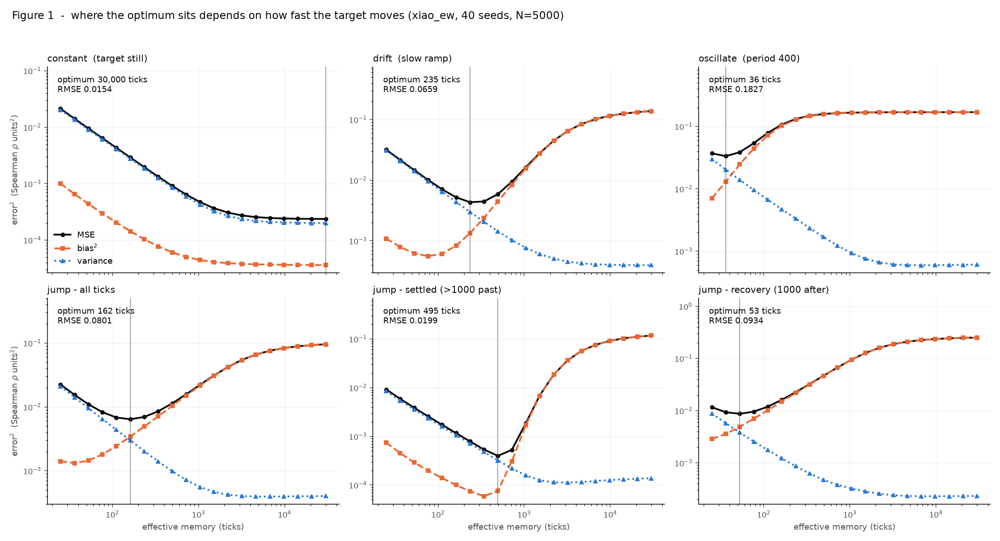
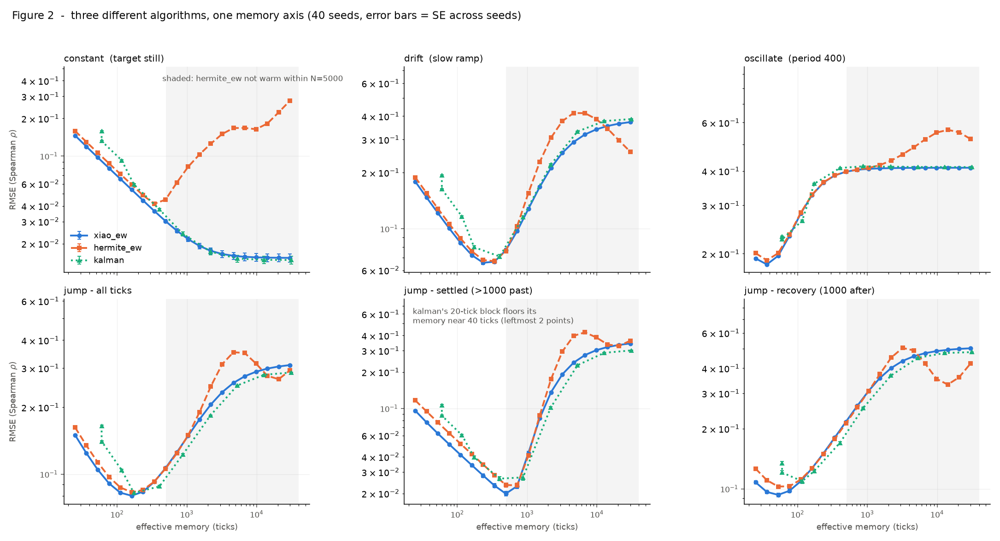

# Memory length is the design variable: a bias²/variance sweep

Branch: `memory-sweep` (off `innovation-variance`). Code: `experiments/probe_memory.cpp`,
`experiments/plot_memory.py`. Data: `experiments/results/memory_sweep.csv`,
`memory_sweep_gap.csv`, `memory_sweep_ess.csv` — regenerated in ~20 s by §7, since
`experiments/results/` is gitignored. Figures are copied to `notes/studies/figures/` so this note
renders from a clean checkout.

> ⚠️ **Platform: macOS / libc++.** A Linux / libstdc++ rerun of the same code (`thesis_audit.md`
> §0.1) reproduces every optimal memory, but RMSEs move by about 1–3 SE; for example `constant`
> reads 0.0187 at M = 9 793 (flat from M ≈ 4 600) instead of 0.0154 at ≥ 30 000. Numbers below are
> the macOS ones. "Memory" here is memory in ticks, equal to the steady-state ESS for these
> fixed-λ schemes (`thesis_audit.md` §6.1).

Every other result in this project reports RMSE, which is `bias² + variance` already summed.
The thesis's framing claim — *efficiency versus adaptation* — is a claim about **memory
length**, and it has two parts that RMSE alone cannot show:

- **Claim 1.** Memory length, not the choice of estimator algorithm, is the dominant design
  variable. Put three different algorithms on one memory axis and their error curves should
  nearly coincide.
- **Claim 2.** The optimal memory *moves* with how fast the dependence moves. On a still target
  longer is always better (variance only); on a fast-moving one the curve is a sharp U with the
  optimum at short memory.

Both are measured here. **Both are confirmed**, with three things that contradict or sharpen the
expectation — §6.

---

## 1. Design

**Estimators, and the mirror-image λ.** `registry.hpp`'s header block and the source both say
it, and it was checked before the grids were built:

| Estimator | λ is | Longer memory means | Confirmed in source |
| --- | --- | --- | --- |
| `xiao_ew` | **retention** | **larger** λ | `xiao_spearman.hpp:188-198` — `counts_ *= lambda` then `+= (1 - lambda)`, so the per-tick update weight is `α = 1 − λ` |
| `hermite_ew` | **update weight** | **smaller** λ | `hermiter.hpp:96-107` — `w = lambda_` and `A_ += w * (outer - A_)`, so `α = λ` |
| `kalman` | `σ_ω²` | **smaller** `σ_ω²` | `kalman_local_level.hpp:62-68` — steady-state gain `K` rises with `q = σ_ω²/σ_v²` |

So the Xiao grid runs **0.923 → 0.999933** (short → long) and the Hermite grid runs
**0.0769 → 6.67e-5** (short → long). They are *not* the same numbers; they are the same memory.

**The common x-axis.** For an exponential filter with update weight `α` the weights are
`α(1−α)^j` and the variance-sense effective sample size is `ESS = (2−α)/α` observations. Both
tick-level estimators consume one observation per tick, so their ESS is already in ticks. The
Kalman consumes a **block of `m = 20` ticks**, with

```
q = σ_ω² / σ_v²,   σ_v² = 1.06/(m−3),   K = (√(q²+4q) − q)/2,   mem_ticks = m·(2−K)/K
```

Rather than pick λ and read off the memory, the probe **inverts** it: a grid of 20 ESS targets
log-spaced 25 → 30 000 ticks, then `α = 2/(ESS+1)`, then `λ = 1−α` for Xiao and `λ = α` for
Hermite. Xiao and Hermite therefore sit on **exactly the same memory grid**, which makes the
Figure-2 comparison a paired test at matched memory rather than an interpolation. The Kalman
gets 10 points of `σ_ω²` log-spaced 1e-7 → 1e0 (nominal memory 31 586 → 22 ticks) as the
reference line.

Configs are constructed inside the probe. Registering 50 keys in `registry.hpp` would have put
them in `all_estimator_keys()` and so into every other harness.

**Scenarios.** `constant`, `jump`, `drift`, `oscillate`, with `N = 5000`, burn-in 500 and jump at
`t = 2500` — read from `main.cpp`/`multiseed.cpp`, not guessed. Gaussian copula. **40 seeds**
(42…81).

`stochastic` is **skipped**: `StochasticDependence(0.01, 0.6, seed+1)` gives every seed a
*different* true path, so there is no common `ρ_true(t)` to decompose a bias around — the
cross-seed spread would mix estimator dispersion with DGP dispersion and the decomposition
would be meaningless. `shape` is also out of scope: its dependence is constant by construction
(only the copula family changes at the break), so it says nothing about memory on the ρ path.

`ρ_true` is the **true Spearman's ρ_S**, taken from `CopulaSource::Sample::rho_s` — the same
quantity `main.cpp` writes as `true_rho_s`, i.e. `(6/π)·asin(d/2)` for the Gaussian family. No
conversion was invented.

## 2. The decomposition, and the self-check

At each tick `t` past burn-in, across seeds `s` (with the `1/S` convention on all three):

```
mean_t  = (1/S) Σ_s ρ̂_s(t)
bias(t) = mean_t − ρ_true(t)
var(t)  = (1/S) Σ_s (ρ̂_s(t) − mean_t)²
mse(t)  = (1/S) Σ_s (ρ̂_s(t) − ρ_true(t))²
```

each averaged over `t` in the window. `mse = bias² + var` is an algebraic identity, so it is
asserted at every tick and the probe exits if it fails. Both passes are computed from the stored
per-seed series, not from `Σx²/S − mean²`, which cancels catastrophically when the variance is
1e-6 against a mean near 0.6.

> **Assert result: PASS.** 1 025 000 tick-level checks (50 configs × 4 scenarios × all windows),
> worst relative residual **9.8e-16** — floating-point exact.

`se_rmse` is the standard error across the 40 per-seed RMSEs. The Xiao–Hermite gap in
`memory_sweep_gap.csv` is **paired within seed** (both estimators see identical data), which is
why its error bars are an order of magnitude tighter than the marginal ones.

## 3. ESS verification: the algebra against a measured step response

`./probe_memory ess` puts each configured estimator on a step from ρ_S = 0.191 to 0.770, averages
the trajectory over 24 seeds, and finds the first crossing of the half-way level. Pre-period 8
predicted half-lives, post-period 8. Predicted half-life is `ln(0.5)/ln(1−α)` observations,
times 20 ticks for the Kalman.

| Estimator | measured / predicted half-life |
| --- | --- |
| `xiao_ew` (ρ domain) | **0.98 – 1.04** over memory 53 → 30 000 ticks; 1.16 at memory 25 |
| `hermite_ew` (ρ domain) | **0.97 – 1.08** over memory 53 → 30 000 ticks; 1.27 at memory 25 |
| `kalman` (**Fisher-z** domain) | **0.99 – 1.01** for memory ≥ 879 ticks; 1.13, 1.18, 1.89 at 360, 148, 63; pinned at 20 ticks below that |

**The algebra is confirmed.** Two things had to be got right for it to be:

1. **Each estimator must be measured in the domain it is linear in.** Measured in ρ, the Kalman
   reads 0.72–0.80 — it looks 27% faster than predicted. It is not: the Kalman filters Fisher-z,
   and on a 0.191 → 0.770 step the ρ-space half-point (0.481) is *below* the ρ corresponding to
   the z-space half-point (0.542), so the trajectory reaches it early. The check of this is that
   Xiao and Hermite show the *reciprocal* distortion — a flat ~1.34 ratio when measured in z
   (they are not z-domain filters) — and 1/1.34 = 0.746 ≈ the Kalman's ρ-space 0.73. The
   discrepancy is entirely the transform, not a memory mismatch. Both columns are in
   `memory_sweep_ess.csv`.
2. **The Kalman's memory cannot go below one block.** Its two shortest grid points (`σ_ω²` = 0.167
   and 1.0, nominal memory 32 and 22 ticks) both measure a half-life of *exactly* 20 ticks — one
   block — i.e. ESS ≈ 40. Here **the measurement wins over the algebra**, and Figure 2 plots the
   Kalman against its measured ESS (`ess_meas`) rather than the nominal one. The block size, not
   `σ_ω²`, sets the Kalman's adaptation floor. That is a design constraint, and §5 shows it
   costing the Kalman the `oscillate` scenario.

Xiao and Hermite are plotted at their predicted ESS, since measurement and algebra agree within
±8% and the shared grid keeps the paired comparison exact.

## 4. Figure 1 — the U-curve, decomposed



`xiao_ew`, 40 seeds. MSE with its two components, log–log, one panel per scenario plus the two
`jump` sub-windows. **Claim 2 is confirmed: the optimum moves by a factor of at least 830** (36
ticks to past 30 000), and by a factor of 14 among the five windows that have an interior
optimum at all.

| Scenario / window | optimal memory (ticks) | RMSE there | shape |
| --- | --- | --- | --- |
| `oscillate` (period 400) | **36** | 0.1827 ± 0.0014 | sharp U |
| `jump` — recovery | **53** | 0.0934 ± 0.0020 | shallow U |
| `jump` — all ticks | **162** | 0.0801 ± 0.0010 | U |
| `drift` | **235** | 0.0659 ± 0.0015 | U |
| `jump` — settled | **495** | 0.0199 ± 0.0009 | sharp U |
| `constant` | **≥ 30 000** (grid edge) | 0.0154 ± 0.0011 | monotone decreasing |

The mechanism is visible in every panel: **variance falls monotonically with memory in all six**
(it is the same 1/ESS curve), and everything that distinguishes the scenarios is in bias². On
`constant` the bias² curve is flat and two to three decades below the variance, so MSE is
variance and longer is always better. On `oscillate` bias² crosses variance at ~40 ticks and then
saturates at the variance of the sine itself, so the optimum is pushed hard to the left. `drift`
and `jump` sit between.

One correction to the naive expectation: on `constant` the bias is **not** zero. It settles at a floor
of `bias² = 3.6e-5`, i.e. `|bias| = 0.006` in ρ — the discretisation bias of Xiao's 20-bin grid.
It is memory-independent, so it does not move the optimum, but "bias ≈ 0" is only true to two
decimal places.

## 5. Figure 2 — memory dominates algorithm



Three algorithms that share no code: a 20×20 empirical-copula count grid, an order-10 Hermite
series, and a Kalman filter on Fisher-z'd 20-tick block Spearman. Shaded region: memory long
enough that `hermite_ew` has not warmed up within the scored window (§6.2).

**The curves nearly coincide, so Claim 1 is confirmed** — but the residual gap is small, not
zero, and it is systematic. Both halves of that sentence are load-bearing.

### 5.1 The scale comparison

| Scenario / window | RMSE range along the memory axis (xiao_ew) | Xiao vs Hermite at matched memory (warm) | Kalman vs Xiao at matched memory |
| --- | --- | --- | --- |
| `constant` | **×9.5** (0.0154 → 0.146) | −8.0 % … −8.8 % | median **+3.9 %** |
| `jump` — all | **×3.9** | −3.5 % … −7.7 % | median **−6.0 %** |
| `jump` — settled | **×17.2** | −19.0 % … +5.9 % | median **+0.3 %** |
| `jump` — recovery | **×5.4** | −14.6 % … +1.8 % | median **−3.9 %** |
| `drift` | **×5.6** | −4.6 % … −5.3 % | median **+6.8 %** |
| `oscillate` | **×2.2** | −0.3 % … −4.3 % | median **+2.4 %** |

Read the columns against each other: **choosing the memory is worth a factor of 2 to 17 in RMSE
(a 120 % to 1600 % swing); choosing the estimator at fixed memory is worth 3–15 % at the optima
and never more than 19 % anywhere in the warm region.** That is Claim 1, quantified. The
"warm" region here is memory ≤ `window_start/2.3`, the largest ESS at which Hermite's EWMA has
accumulated ≥99 % of its weight by the time scoring begins (217 ticks for `all`, 1522 for
`settled`, 1087 for `recovery`). The Xiao–Hermite column is exact (shared grid, paired seeds);
the Kalman column is log-interpolated onto Xiao's grid over the Kalman's own memory range, so it
carries no error bar and is quoted as a median.

### 5.2 The headline number: Xiao versus Hermite at matched memory

Paired over 40 seeds, at each scenario's best memory **within the warm region** of §5.1. (For
`constant` and `drift` the unrestricted optimum — 30 000 and 235 ticks — lies outside the region
where Hermite has warmed up, so those two rows use 162 ticks, the best warm point. Nothing else
is restricted.)

| Scenario / window | optimum | `xiao_ew` | `hermite_ew` | gap (paired) | t | significant? |
| --- | --- | --- | --- | --- | --- | --- |
| `constant` | 162 | 0.0540 | 0.0591 | **−0.0052 ± 0.0005** (−8.8 %) | −10.1 | yes |
| `jump` — all | 162 | 0.0801 | 0.0830 | **−0.0029 ± 0.0005** (−3.5 %) | −6.0 | yes |
| `jump` — settled | 495 | 0.0199 | 0.0235 | **−0.0036 ± 0.0009** (−15.4 %) | −3.9 | yes |
| `jump` — recovery | 53 | 0.0934 | 0.1027 | **−0.0093 ± 0.0007** (−9.1 %) | −13.1 | yes |
| `drift` | 162 | 0.0723 | 0.0758 | **−0.0035 ± 0.0006** (−4.6 %) | −6.2 | yes |
| `oscillate` | 36 | 0.1827 | 0.1892 | **−0.0064 ± 0.0007** (−3.4 %) | −9.4 | yes |

Across the warm region the gap runs **−19 % to +5.9 %** with |t| up to 29. Of the 47 warm grid
points: **38 favour Xiao at |t| > 2, 5 are indistinguishable, and 4 favour Hermite** — the four
by at most 5.9 %, and all four at memory lengths well past their window's own optimum
(`jump`/recovery at 341–719 ticks where the optimum is 53; `jump`/settled at 1044 where the
optimum is 495). **At every scenario's own optimum, and at every memory ≤ 235 ticks, Xiao is
better or statistically tied.** With 40 paired seeds a 3 % difference is 6σ, so the Xiao
advantage where it appears is not noise — but neither is it universal, and the note does not
claim it is.

**The gap is pure variance.** At matched memory the two estimators' bias² agree to about three
significant figures (`constant`, memory 25: 1.007e-3 vs 9.953e-4; memory 161: 1.440e-4 vs
1.123e-4) while Hermite's variance is consistently larger:

| Scenario / window | var(hermite) / var(xiao), warm region |
| --- | --- |
| `constant` | 1.19 – 1.23 |
| `jump` — all | 1.18 – 1.23 |
| `jump` — settled | 1.52 – 1.63 |
| `jump` — recovery | 1.41 – 1.55 |
| `drift` | 1.11 – 1.14 |
| `oscillate` | 1.11 – 1.12 |

So the answer to "do the two curves coincide?" is: **they coincide in shape, in optimum and in
scale, and they differ by a constant multiplicative variance penalty.** An order-10 truncated
Hermite series is 11–23 % (up to 63 % in the settled window) less statistically efficient than a
20-bin empirical-copula grid at the same memory, which costs 3–19 % in RMSE depending on how
much of the MSE is variance in the first place. That is a real,
reproducible scientific reason for the two estimators to both exist — the *representation*
carries a measurable efficiency cost — and it is second-order next to memory. The two candidate
outcomes ("they coincide, so the zoo is second-order" and "they differ, so representation
matters") are **both true at once**, at magnitudes an order apart.

### 5.3 The Kalman, and where matched memory stops being matched

The Kalman tracks Xiao within a few percent (median +0.3 % to +6.8 %) despite being a completely
different construction. The exception is `oscillate`, where its best RMSE is **0.2253** against
Xiao's **0.1827** — 23 % worse — because the optimum there is 36 ticks and the Kalman's 20-tick
block cannot deliver it (§3, point 2). Block averaging also adds a phase lag that an ESS number
does not capture. Memory dominates, but only over algorithms that can *reach* the memory you
need.

### 5.4 Cross-check against the existing `oscillate` tuning sweep

`notes/todo.md` already records a per-family forgetting sweep on `oscillate` (20 seeds, a
different probe, a different seed base). It lands on the same numbers:

| family | todo.md best setting | todo.md RMSE | this sweep, nearest grid point | this sweep RMSE |
| --- | --- | --- | --- | --- |
| Xiao | λ = 0.95 | 0.1826 | λ = 0.9464 (memory 36) | **0.1827** |
| Hermite | λ = 0.05 | 0.1879 | λ = 0.0536 (memory 36) | **0.1892** |
| Kalman | σ_ω² = 0.3 | 0.2256 | σ_ω² = 0.167 (memory 32) | **0.2253** |

Independent replication to three decimal places. It also explains *why* the tuned Xiao and
Hermite beat the tuned Kalman by ~19 % on `oscillate`, which todo.md records as an unexplained
"block-aggregation ceiling": the ceiling is the 20-tick block floor of §3, and this sweep
measures it directly rather than inferring it from a plateau.

## 6. What was confirmed, and what was not

### 6.1 Confirmed

- **Claim 2 in full.** `constant` is monotone decreasing (variance only, flat bias²);
  `oscillate` is a sharp U at 36 ticks; `drift` and `jump` sit between. The optimum moves from
  36 ticks to past 30 000 as the target slows.
- **Claim 1 in full.** Three unrelated algorithms fall on one curve when plotted against
  effective memory. Memory is worth ×2–×17 in RMSE; algorithm is worth 3–15 % at the optima and
  at most 19 % anywhere warm.
- **The `jump` three-way cut, exactly as predicted.** Long memory wins on `settled` (optimum 495
  ticks), short memory wins on `recovery` (optimum 53 ticks) — a **factor of 9.4** — and the
  all-ticks optimum (162) is a blend, with recovery making up 1000/4500 = 22 % of the scored
  sample. Neither setting is tolerable for the other window: tuned for `settled` (495 ticks),
  recovery RMSE is 0.2165 against its own best 0.0934 (**2.3× worse**); tuned for `recovery`
  (53 ticks), settled RMSE is 0.0622 against its own best 0.0199 (**3.1× worse**). That is the
  efficiency-versus-adaptation tradeoff the thesis is named after, in one number, and it is the
  quantitative case for a detector or a variable forgetting factor: a single fixed λ pays 2–3×
  on one side or the other.
- **The ESS algebra**, within ±8 % for both tick-level estimators over three decades of memory,
  and within ±1 % for the Kalman above 900 ticks once it is measured in Fisher-z.

### 6.2 Refuted / sharpened

**(a) The two curves do not simply "coincide or not".** They coincide to within 10 % *and* the
residual gap is overwhelmingly significant (|t| up to 29) with a consistent sign. Reporting only
"they coincide" would hide a real representation effect; reporting only "they differ, p ≪ 0.001"
would hide that the effect is an order of magnitude smaller than the memory effect. Both belong
in the thesis.

**(b) `hermite_ew` has no EWMA initialisation debiasing, and this is a real defect.** Its update
is `A_ += λ(outer − A_)` from `A_ = 0`, so after `t` ticks only `1 − (1−λ)^t` of the weight has
accumulated and the estimate is shrunk toward zero. There is no `/(1 − (1−λ)^t)` correction.
Xiao is immune because its estimate is a *scale-invariant ratio* of the EWMA'd counts, so the
same shrinkage cancels. Direct check (seed 42, `constant`, true ρ_S = 0.582):

| memory (ESS) | `t` = 5 000 | `t` = 20 000 | `t` = 100 000 | `t` = 400 000 |
| --- | --- | --- | --- | --- |
| 4 643 | herm **0.436** / xiao 0.581 | 0.566 / 0.566 | 0.576 / 0.578 | 0.586 / 0.588 |
| 30 000 | herm **0.450** / xiao 0.580 | herm **0.384** / xiao 0.577 | 0.575 / 0.574 | 0.587 / 0.583 |

Hermite recovers once `t ≳ 3·ESS`. So the upward turn of the orange curve above ~500 ticks in
Figure 2 is **a warm-up artifact, not a memory effect**, and that region of Figure 2 must not be
read as "long memory is bad for Hermite". The sweep's own variance column corroborates it: at
memory 30 000 on `constant`, Hermite's cross-seed variance is 8.6e-7 — the estimate is essentially
deterministic, which is what a cold-start transient looks like and what sampling noise does not.

Consequences for the repo: the registered `hermite_ew` (λ = 0.01, ESS 199) and `hermite_ew20`
(λ = 0.01) are **inside** the warm region at N = 5000, so **no existing measurement is
invalidated**. But any future Hermite config with λ ≲ 0.002 at this N would be measuring warm-up
rather than memory, and `hermite_bank`'s longest arm (λ = 0.001, ESS 1999) is already at the
edge. A one-line debias in `estimate()` would remove the trap; it is not made here because it
would change every registered Hermite number at once.

**(c) The Kalman's memory has a floor at one block.** `σ_ω²` = 0.167 and `σ_ω²` = 1.0 have nominal
memories of 32 and 22 ticks and *identical* measured half-lives of 20 ticks. Anything in
`registry.hpp` that tunes `σ_ω²` above ~0.03 while holding `block = 20` is turning a knob that
has stopped moving. `kalman_fast` (`σ_ω²` = 1e-2, memory ≈ 102 ticks) is already near the
practical short end of that filter; `kalman_q1` and `kalman_q10` are not distinguishable from
each other in memory at all.

## 7. Reproduction

```bash
cd experiments
mkdir -p results
make probe_memory
./probe_memory            # ~9 s: results/memory_sweep.csv, memory_sweep_gap.csv
./probe_memory ess        # ~9 s: results/memory_sweep_ess.csv
../.venv/bin/python plot_memory.py
```

`memory_sweep.csv` columns: `estimator, scenario, window, param, mem_ticks, bias2, var, mse,
rmse, se_rmse`. `param` is λ for the tick-level estimators and `σ_ω²` for the Kalman; `window` is
`all` for every scenario plus `settled` and `recovery` for `jump`.

## 8. Limitations

- One copula family (Gaussian) and one DGP amplitude per scenario. The optimum-memory *values*
  are specific to these; the *ordering* and the decomposition mechanism are not.
- `oscillate`'s optimum (36 ticks) is close to the short end of the grid (25 ticks) and the U is
  shallow there; a finer short grid would pin it better.
- `constant`'s optimum is at the grid edge (30 000 ticks) by construction — with a still target
  and N = 5000 the answer is "cumulative", and the grid stops before the curve does.
- Xiao's 20 bins and Hermite's order 10 are the registered values. §5.2's efficiency gap is a
  statement about *those two configurations*, not about the two method families in general; the
  resolution sweep (`hermite_o20`, `hermite_o40`, `xiao_b8`, `xiao_b40`) is the other axis and
  was not crossed with memory here.

## 9. Absolute check of $M^*=(2\sigma^2/d^2)^{1/3}$ on `drift` (2026-11-04)

**Platform:** Linux x86_64 / libstdc++, `./probe_memory` rerun at `3c8b13d`, 40 seeds (42–81),
Gaussian, `drift` window `all` (ticks 500–5000). Script: `experiments/fit_mstar.py`. No new
estimator code; this is `thesis_audit.md` §3 SHOULD-6.

**Inputs, none fitted to the MSE curve.**
- $d$ is taken from the true path: $r_t$ is linear from −0.5 to 0.8, so
  $\rho_S=(6/\pi)\arcsin(r/2)$ moves at $d_t$, with an rms of $2.54\times10^{-4}$ per tick (nearly
  constant).
- $\sigma^2$ is var × M, taken as the median over $M\in[50,2000]$, from either `drift` itself or
  `constant`.
  - The `constant` value is biased low, because `constant` sits at ρ = 0.6, where per-tick
    variance is smaller than along the drift path.

**Model components.**
- **Variance:** Xiao's var × M stays within 0.70–0.89 on `drift`, so $\sigma^2/M$ holds.
- **Lag bias:** with the memory-dependent floor from `constant` subtracted, |bias| divided by
  $dM/2$ is:
  - 1.03–1.11 near the optimum;
  - 0.85–0.98 at long memories;
  - above 1.2 only below M ≈ 100, where the subtracted floor (taken at ρ = 0.6) is the wrong one.

| Estimator | $\sigma^2$ drift / constant | $M^*$ observed | predicted, drift $\sigma^2$ (ratio) | predicted, constant $\sigma^2$ (ratio) | MSE penalty at predicted |
| --- | --- | --- | --- | --- | --- |
| `xiao_ew` | 0.72 / 0.46 | 277 | 282 (1.02) | 243 (0.88) | +0.1 % |
| `hermite_ew` | 0.81 / 0.56 | 286 | 294 (1.03) | 258 (0.90) | ≈ 0 |
| `kalman` | 0.82 / 0.52 | 266 | 295 (1.11) | 253 (0.95) | < grid resolution |

- **The formula predicts the drift optimum to within 2–3 % for Xiao and Hermite**, using the
  path's $d$ and the stream's own $\sigma^2$.
- **The MSE curve is flat near its minimum.** Using the predicted M instead of the measured one
  costs ≤ 0.1 % MSE.
- **With $\sigma^2$ taken from `constant`**, as SHOULD-6 specified, the prediction is 5–12 % short.
  The cause is $\sigma^2(\rho)$, not the model: what enters is the variance along the path. The
  constant is still right within the $1/3$ power.
- **The Kalman ratio is grid-limited.** Its σ_ω² grid has only 4 points in 50–2000 ticks.
- **What this supersedes:** the rough absolute check in `async_memory.md` (790 vs 636–711) was a
  different run (T = 20 000) with $\sigma^2\approx1$ assumed.
- **What it does not cover:**
  - non-Gaussian families;
  - the bank;
  - `oscillate` and `jump`, where d is not locally constant and the cube-root law is not the
    relevant one; for jumps see the square-root law in `tail_dependence.md`.
